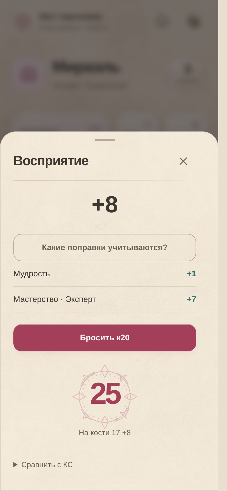
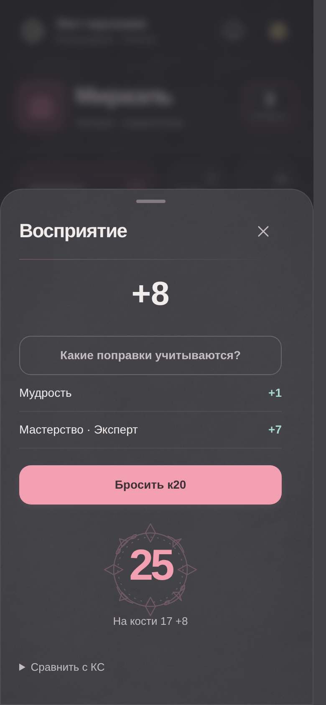

# Визуальные детали 2.8.7

В интерфейсе появился общий мотив тонкой компасной печати: у результата броска,
в пустых блоках и небольших акцентах заголовков. Бумажные светлая/тёмная темы,
названия разделов и привычное расположение действий сохранены.

- Указатель активной вкладки плавно перемещается между кнопками, включая
  вертикальную навигацию на широком экране.
- Нажатие даёт короткую волну чернил внутри границ кнопки. Эффект не принимает
  события мыши/касания, поддерживает клавиатуру и удаляется после завершения.
- Итог броска появляется с компасной печатью. Показывается сразу вычисленный
  результат; декоративная анимация не перебирает числа и не вызывает новый бросок.
- Карточки получили тонкую подсветку края, портрет и уровень — небольшую рамку,
  заголовки — ромбовидные отметки. Сердце в блоке здоровья мягко пульсирует.
- Изменённое числовое значение коротко выделяется. Страница и результаты поиска
  не скрываются и не затухают при обычном обновлении.
- Подсказка поиска продолжает текущую фразу при повторной отрисовке. Набор
  останавливается при фокусе, введённом запросе, открытом диалоге, скрытой
  странице и включении уменьшения движения.

Все динамические декоративные эффекты используют opacity/transform; модуль
реагирует на действия и изменения значений, не запускает декоративный JS-таймер.
Сердцебиение и обводка поиска приостанавливаются в фоне и под диалогом. При
`prefers-reduced-motion: reduce` движения отключаются.

## Проверки

`scripts/check_visual_browser.cjs` проверяет в настоящем Chromium:

- Соответствие указателя геометрии кнопки и отсутствие горизонтальной прокрутки
  на 320, 390 и 1280 пикселях.
- Неизменность введённого запроса, действие с клавиатуры и сохранение здоровья.
- Точный итог броска, обе темы и отсутствие ошибок JavaScript.
- Удаление волн нажатия, остановку при уменьшении движения и событии скрытия.

В проверке спокойного экрана листа счётчик Layout не увеличился. Это проверка
работы браузера в конкретном сценарии, не измерение FPS физического телефона.
Повторно проверены развороты сворачивания умений, обе целые группы, положение
внизу страницы и переключение вкладок. Предыдущая оптимизация сворачивания
сохраняется.

Сайт, APK и единая встроенная HTML-страница IPA собираются из одних 60 исходных
файлов. Android использует прежний сертификат подписи и сборку 286. Нативный
Android DEX и исполняемый файл iOS не изменены относительно 2.8.6. В IPA сохранён
допуск ProMotion. Формат персонажа, расчёты и правила не меняются.

Физические устройства здесь не проверялись. Браузерная проверка IPA использует
локальный HTTP и модели нативных мостов; установки и реальная частота кадров
проверяются на устройстве.

## Пример результата броска

Светлая и тёмная темы на проверочном персонаже:

